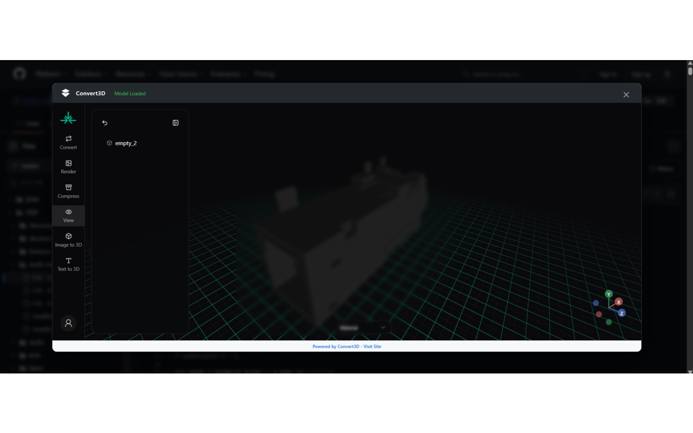
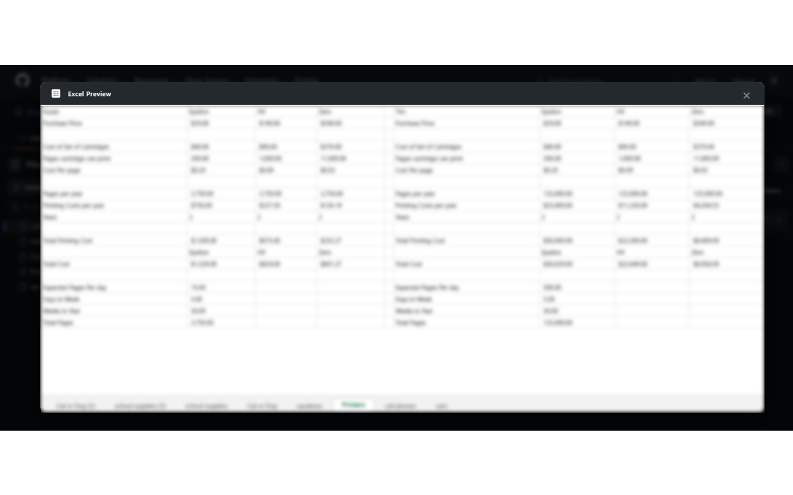
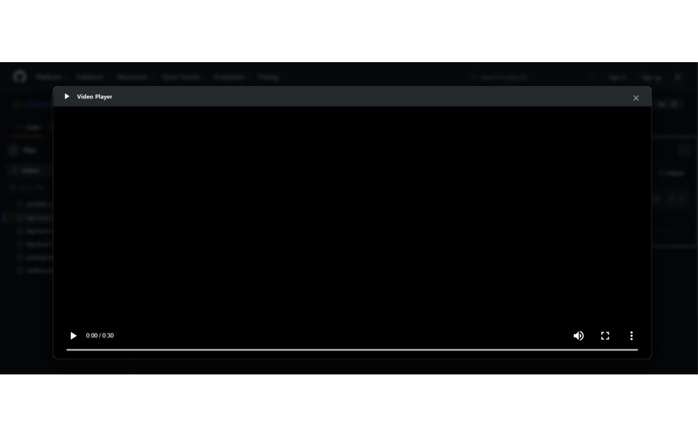

# Viewer Helper for GitHub

GitHub’da kaynak dosyalarını incelerken desteklenen dosyaları indirmeden önizleme araçlarına ulaşmayı kolaylaştırmak için hazırlanmış Chrome eklentisi.

İlk aktarımın kaynak tabanı: **1.1** · Chrome Manifest V3

[Güncel GitHub sürümü ve kurulum ZIP’i](https://github.com/furkanyrtsvr/google-extensions/releases?q=viewer-helper-github-v&expanded=true)

## Özellikler

- Gerber/PCB dosyaları için Tracespace ve KiCad dosyaları için KiCanvas bağlantılı önizleme.
- Desteklenen 3B dosyalar için Convert3D bağlantılı görüntüleme.
- Video/ses oynatma ve XLS/XLSX/CSV tablo önizlemesi.
- Desteklenen GitHub dosya sayfalarına bağlama göre önizleme düğmesi ekleme; Altium için harici görüntüleyici yönlendirmesi.

## Kurulum

Chrome Web Store kimliği: `dbihgppophcfiamgjhjfpeccoappbnlm`. [Mağaza sayfası](https://chromewebstore.google.com/detail/dbihgppophcfiamgjhjfpeccoappbnlm). Mağazanın güncel yayın durumu bu aktarımda doğrulanmadı.

Kaynak kodundan kurulum:

1. `google-extensions` deposunu klonlayıp `02-viewer-helper-github/` klasörünü kullanın veya yukarıdaki bağlantıdan yalnızca bu eklentinin kurulum ZIP’ini indirip açın.
2. Chrome’da `chrome://extensions` sayfasını açın.
3. Geliştirici modunu açın ve **Paketlenmemiş öğe yükle / Load unpacked** seçeneğini kullanın.
4. Doğrudan `manifest.json` içeren klasörü seçin.
5. Eklentiyi araç çubuğuna sabitleyin. Kaynağı güncellediğinizde eklenti kartındaki Yeniden yükle düğmesine basın ve hedef sayfayı yenileyin.

Node.js/npm kurulumu eklentiyi kullanmak için gerekmez. Edge’de geliştirici modu ve paketlenmemiş eklenti akışı benzerdir; bu aktarımda ayrıca doğrulanmadı.

## Kullanım

GitHub’da desteklenen bir dosyanın blob sayfasını açın. Raw düğmesinin yakınındaki Preview/Play düğmesini kullanın. Altium yönlendirmesinde dosyayı indirip harici görüntüleyiciye sürüklemek gerekir. Bu eklentinin ayrı bir popup penceresi yoktur.

## Görseller

Aşağıdaki dört görsel kullanıcı tarafından sağlanan tanıtım arşivinden alınmıştır.

### PCB/KiCad önizlemesi


### 3B dosya önizlemesi



### Excel/tablo önizlemesi



### Medya oynatma



## İzinler ve veri akışı

declarativeNetRequest ve GitHub, raw.githubusercontent.com, tracespace.io, kicanvas.org, convert3d.org host erişimleri. Harici görüntüleyici akışları dosya adreslerini ilgili servislere iletebilir.

## Geliştirme ve kontrol

Komutları deponun `02-viewer-helper-github/` klasöründe çalıştırın.

```sh
node scripts/check-extension.mjs
```

Kontrol, manifestte başvurulan dosyaları ve JavaScript sözdizimini doğrular. Bu, gerçek Chrome uzantı API’lerinin veya harici sitelerin uçtan uca kabul testi değildir.

## Sınırlar

Harici görüntüleyiciler internet erişimi ve kendi dosya biçimi desteğini gerektirir. Özel GitHub dosyalarının üçüncü taraf servislerde açılabildiği garanti edilmez; özel dosyaları göndermeden önce veri paylaşımını değerlendirin. Tarayıcı codec desteği medya oynatımını sınırlar.

## Sürümler ve kaynak düzeni

`manifest.json` eklenti giriş noktalarını tanımlar. README görselleri `docs/images/`, yerel kontrol araçları `scripts/`, ortak paketleme/sürüm araçları deponun `../maintenance/scripts/` altındadır. Chrome tarafından üretilen `_metadata` dosyaları kaynak depoya alınmadı. Manifestteki `key` mağaza kimliğini koruyan açık anahtardır; özel imzalama anahtarı değildir.

`google-extensions` deposunun main dalında bu eklentinin çalışma dosyaları değiştiğinde kontrollerden sonra bağımsız `viewer-helper-github-vMAJOR.MINOR.PATCH` etiketi, GitHub Release ve kurulum ZIP’i üretilir. Diğer eklentilerin sürümü değişmez; yalnızca README/görsel değişiklikleri yeni sürüm çıkarmaz. GitHub sürümü yayımlamak Chrome Web Store’a otomatik gönderim yapmaz. [Sürüm rehberi](docs/SURUMLEME.md).

## Lisans

Bu kaynak aktarımı yeni bir proje lisansı atamaz. Depodaki üçüncü taraf kütüphanelerin gömülü telif ve lisans bildirimleri korunmuştur. Ayrı bir açık kaynak lisansı belirlenmeden kullanım/dağıtım haklarının serbest olduğu varsayılmamalıdır.

[← Google Extensions koleksiyonu](../README.md)
