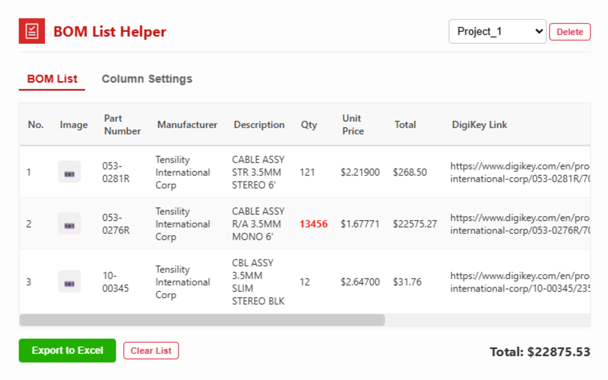
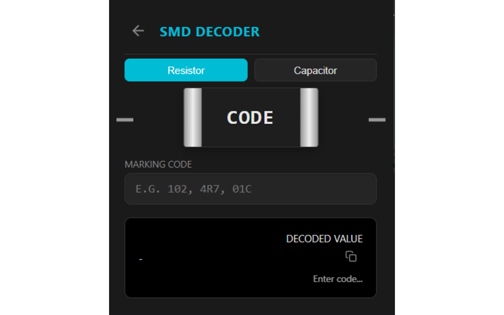
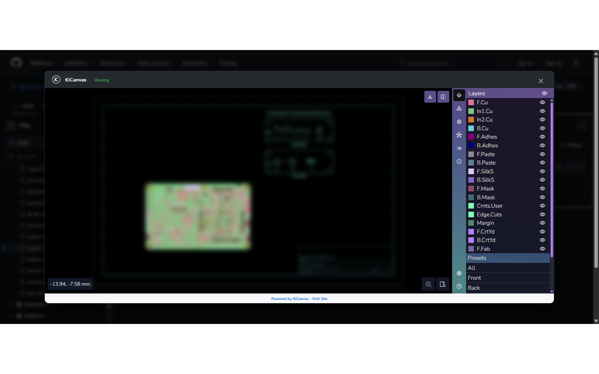

# Google Extensions

Elektronik tasarım, mühendislik hesapları, malzeme listeleri ve GitHub dosya önizlemeleri için geliştirilmiş dört Chrome eklentisi. Her eklenti kendi klasöründe; ayrı README, dört tanıtım görseli, manifest ve bağımsız sürüm geçmişi içerir.

| Eklenti | Amacı | Taşınan sürüm | İndir |
| --- | --- | --- | --- |
| [BOM List Helper for DigiKey](bom-list-helper-digikey/README.md) | DigiKey ürünlerinden proje bazlı BOM listeleri ve Excel çıktısı. | 1.0.0 | [Sürümler ve ZIP](https://github.com/furkanyrtsvr/google-extensions/releases?q=bom-list-helper-digikey-v&expanded=true) |
| [PCB Guard](pcb-guard/README.md) | Çevrimdışı PCB iz, via, açıklık ve empedans hesapları. | 1.0.1 | [Sürümler ve ZIP](https://github.com/furkanyrtsvr/google-extensions/releases?q=pcb-guard-v&expanded=true) |
| [Unit Converter](unit-converter/README.md) | Mühendislik birimleri ve elektronik hesaplamaları. | 1.1.0 | [Sürümler ve ZIP](https://github.com/furkanyrtsvr/google-extensions/releases?q=unit-converter-v&expanded=true) |
| [Viewer Helper for GitHub](viewer-helper-github/README.md) | GitHub dosyaları için PCB, KiCad, 3B, medya ve tablo önizleme. | 1.1.0 | [Sürümler ve ZIP](https://github.com/furkanyrtsvr/google-extensions/releases?q=viewer-helper-github-v&expanded=true) |

## Kurulum

1. Tablodaki ilgili eklentinin **Sürümler ve ZIP** bağlantısını açın.
2. Release içindeki eklenti adına ait **kurulum ZIP’ini** indirin ve çıkarın.
3. Chrome’da `chrome://extensions` sayfasını açıp geliştirici modunu etkinleştirin.
4. **Paketlenmemiş öğe yükle / Load unpacked** ile doğrudan `manifest.json` içeren klasörü seçin.

Kaynak kodunu klonladıysanız koleksiyonun kökünü değil, ilgili eklentinin klasörünü seçin. Her eklenti ayrı yüklenir. GitHub’ın otomatik **Source code** arşivi, hazır kurulum ZIP’inden farklıdır. Node/Python yalnızca geliştirme araçları için gerekir.

## Eklentilerden görseller

### BOM List Helper for DigiKey

### PCB Guard

### Unit Converter

### Viewer Helper for GitHub

Her eklentinin kendi README’sinde dört görsel ve ayrıntılı kullanım adımları bulunur.

## Bağımsız sürümler

Örneğin yalnızca PCB Guard’ın çalışma kodu değişirse `pcb-guard-v1.0.2` yayımlanır; diğer üç eklentinin sürümü korunur. README ve tanıtım görseli güncellemeleri sürüm numarasını artırmaz. Kurulum ZIP’leri yalnızca ilgili eklentinin çalışma dosyalarını içerir.

[Geliştirme, kontroller ve otomatik yayın rehberi](docs/SURUMLEME.md) · [Taşıma kaydı](docs/TASIMA.md)

Bu depo Chrome Web Store’a otomatik gönderim yapmaz. Eklentilerin izinleri, veri akışı ve mevcut lisans bildirimleri kendi README’lerinde açıklanmıştır.
