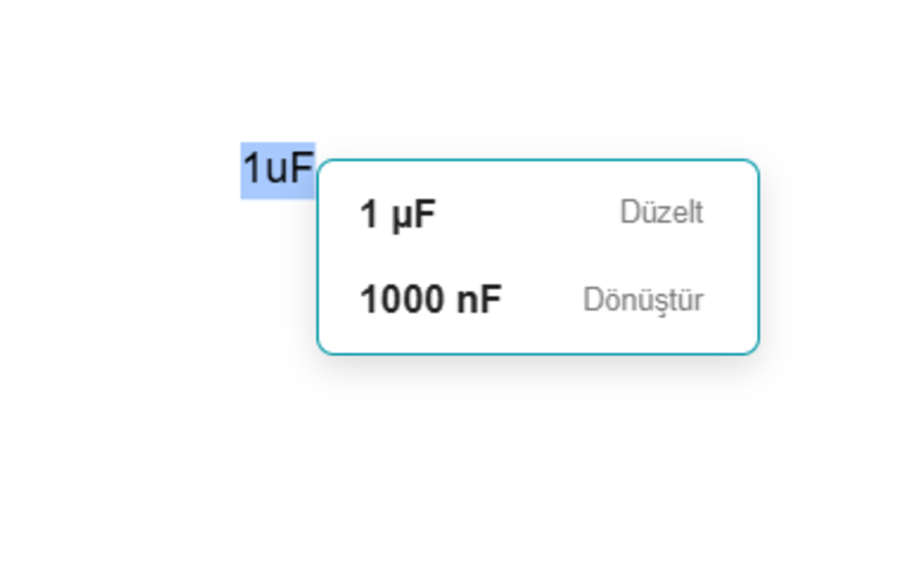

# Unit Converter

Mühendislik birim dönüşümlerini ve temel elektronik yardımcılarını tarayıcıdan ayrılmadan kullanabilmek için hazırlanmış Chrome eklentisi.

İlk aktarımın kaynak tabanı: **1.1** · Chrome Manifest V3

[Güncel GitHub sürümü ve kurulum ZIP’i](https://github.com/furkanyrtsvr/unit-converter/releases/latest)

## Özellikler

- Uzunluk, kütle, kuvvet, basınç, enerji, güç, sıcaklık, zaman, frekans ve diğer kategorilerde dönüşüm.
- Seçilen sayfa metni için kayan dönüşüm yardımcısı.
- Direnç renk kodu ile değer arasında dönüşüm; SMD direnç/kondansatör kod çözümü.
- İndirme süresi hesabı; kategori/birim tercihleri ve tema ayarları.

## Kurulum

Chrome Web Store kimliği: `mommgdhpboankjnbdoiphmljmekfhjja`. [Mağaza sayfası](https://chromewebstore.google.com/detail/mommgdhpboankjnbdoiphmljmekfhjja). Mağazanın güncel yayın durumu bu aktarımda doğrulanmadı.

Kaynak kodundan kurulum:

1. Depoyu klonlayın veya GitHub Release ZIP’ini indirip açın.
2. Chrome’da `chrome://extensions` sayfasını açın.
3. Geliştirici modunu açın ve **Paketlenmemiş öğe yükle / Load unpacked** seçeneğini kullanın.
4. Doğrudan `manifest.json` içeren klasörü seçin.
5. Eklentiyi araç çubuğuna sabitleyin. Kaynağı güncellediğinizde eklenti kartındaki Yeniden yükle düğmesine basın ve hedef sayfayı yenileyin.

Node.js/npm kurulumu eklentiyi kullanmak için gerekmez. Edge’de geliştirici modu ve paketlenmemiş eklenti akışı benzerdir; bu aktarımda ayrıca doğrulanmadı.

## Kullanım

Eklenti penceresinde kategori, giriş/çıkış birimlerini seçip değeri yazın. Direnç ve SMD modlarını ilgili kategori üzerinden açın. Sayfadaki desteklenen ölçü metnini seçerek kayan yardımcıyı kullanın; Options bölümünden birim tercihlerini değiştirin.

## Görseller

Aşağıdaki dört görsel kullanıcı tarafından sağlanan tanıtım arşivinden alınmıştır.

### SMD kod çözücü


### Direnç renk hesabı


### Birim dönüşüm penceresi


### Sayfa üzerinde kayan dönüşüm



## İzinler ve veri akışı

storage: tercihler; clipboardWrite: sonuç kopyalama. Content script tüm adreslerde ve çerçevelerde çalışacak şekilde tanımlıdır; Chrome’un kısıtladığı dahili sayfalarda çalışmaz.

## Geliştirme ve kontrol

```sh
node scripts/check-extension.mjs
```

Kontrol, manifestte başvurulan dosyaları ve JavaScript sözdizimini doğrular. Bu, gerçek Chrome uzantı API’lerinin veya harici sitelerin uçtan uca kabul testi değildir.

## Sınırlar

Sayfa üzerindeki yardımcı, algılanabilen metin/birim biçimleriyle sınırlıdır. Gösterim yuvarlamaları ve sayfa bağlamı kontrol edilmelidir.

## Sürümler ve kaynak düzeni

`manifest.json` eklenti giriş noktalarını tanımlar. README görselleri `docs/images/`, kontrol/paketleme araçları `scripts/` altındadır. Chrome tarafından üretilen `_metadata` dosyaları kaynak depoya alınmadı. Manifestteki `key` mağaza kimliğini koruyan açık anahtardır; özel imzalama anahtarı değildir.

main dalındaki değişiklikler kontrollerden sonra otomatik GitHub Release ve paketlenmemiş kurulum ZIP’i üretir. GitHub sürümü yayımlamak Chrome Web Store’a otomatik gönderim yapmaz. [Sürüm rehberi](docs/SURUMLEME.md).

## Lisans

Bu kaynak aktarımı yeni bir proje lisansı atamaz. Depodaki üçüncü taraf kütüphanelerin gömülü telif ve lisans bildirimleri korunmuştur. Ayrı bir açık kaynak lisansı belirlenmeden kullanım/dağıtım haklarının serbest olduğu varsayılmamalıdır.
