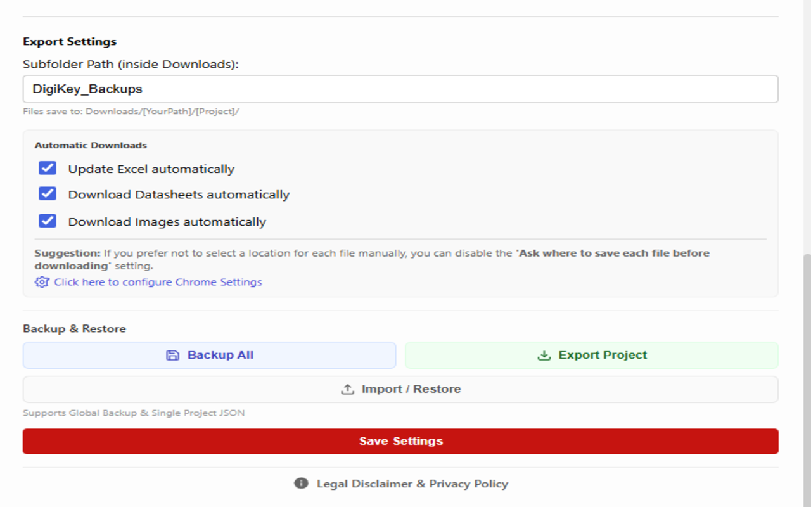
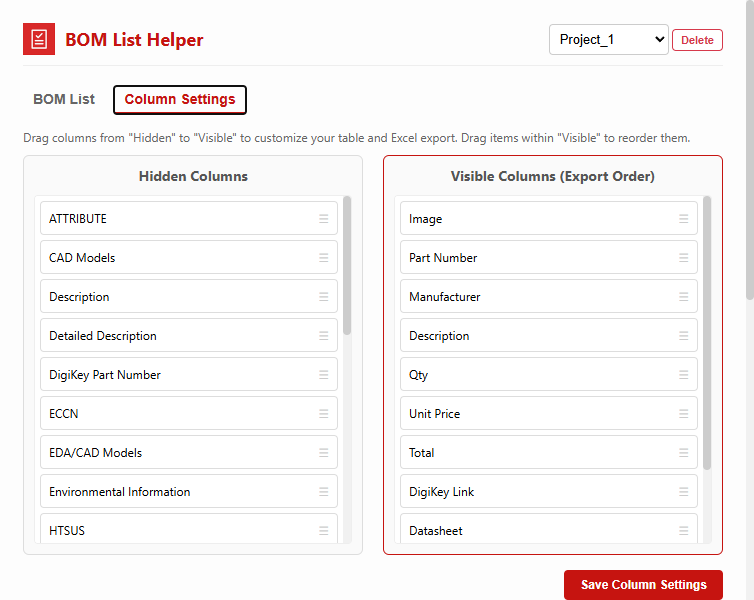

# BOM List Helper for DigiKey

DigiKey ürünlerini tek tek kopyalama işini azaltmak ve elektronik projelerin malzeme listelerini proje bazında toplamak için hazırlanmış Chrome eklentisi.

İlk aktarımın kaynak tabanı: **1.0** · Chrome Manifest V3

[Güncel GitHub sürümü ve kurulum ZIP’i](https://github.com/furkanyrtsvr/google-extensions/releases?q=bom-list-helper-digikey-v&expanded=true)

## Özellikler

- DigiKey ürün sayfalarından parça numarası, üretici, açıklama, fiyat ve ürün bağlantısını BOM listesine ekleme.
- Birden fazla proje/listede çalışma; miktar, notlar ve toplamları düzenleme.
- Görünür ve dışa aktarılacak sütunları seçme ve sıralama.
- Excel çıktısı; yedek alma/geri yükleme ve isteğe bağlı görsel/datasheet indirme ayarları.

## Kurulum

Chrome Web Store kimliği: `elebnflejdljoccmehkeepkgadijbjgm`. [Mağaza sayfası](https://chromewebstore.google.com/detail/elebnflejdljoccmehkeepkgadijbjgm). Mağazanın güncel yayın durumu bu aktarımda doğrulanmadı.

Kaynak kodundan kurulum:

1. `google-extensions` deposunu klonlayıp `bom-list-helper-digikey/` klasörünü kullanın veya yukarıdaki bağlantıdan yalnızca bu eklentinin kurulum ZIP’ini indirip açın.
2. Chrome’da `chrome://extensions` sayfasını açın.
3. Geliştirici modunu açın ve **Paketlenmemiş öğe yükle / Load unpacked** seçeneğini kullanın.
4. Doğrudan `manifest.json` içeren klasörü seçin.
5. Eklentiyi araç çubuğuna sabitleyin. Kaynağı güncellediğinizde eklenti kartındaki Yeniden yükle düğmesine basın ve hedef sayfayı yenileyin.

Node.js/npm kurulumu eklentiyi kullanmak için gerekmez. Edge’de geliştirici modu ve paketlenmemiş eklenti akışı benzerdir; bu aktarımda ayrıca doğrulanmadı.

## Kullanım

Bir DigiKey ürün sayfasını açın, eklentinin eklediği BOM kontrolünü kullanın. Araç çubuğundan eklentiyi açıp proje seçin, miktarları/sütunları düzenleyin ve Export ile çıktıyı alın. Dosya indirme seçeneklerini Settings bölümünden ayarlayın.

## Görseller

Aşağıdaki dört görsel kullanıcı tarafından sağlanan tanıtım arşivinden alınmıştır.

### Proje bazlı BOM tablosu


### Sütun seçimi ve sıralama


### Dışa aktarma ve yedek ayarları



### Özelleştirilebilir görünüm



## İzinler ve veri akışı

storage: proje ve ayarlar; activeTab/scripting: ürün sayfasıyla çalışma; downloads: dosya çıktıları. Manifest DigiKey alanlarına ek olarak <all_urls> erişimi de ister; kaynak aktarımında izin kapsamı değiştirilmedi.

## Geliştirme ve kontrol

Komutları deponun `bom-list-helper-digikey/` klasöründe çalıştırın.

```sh
node scripts/check-extension.mjs
```

Kontrol, manifestte başvurulan dosyaları ve JavaScript sözdizimini doğrular. Bu, gerçek Chrome uzantı API’lerinin veya harici sitelerin uçtan uca kabul testi değildir.

## Sınırlar

Ürün verileri DigiKey sayfa düzenine ve erişilebilirliğine bağlıdır. Listede tutulan fiyat, güncel satın alma fiyatı garantisi değildir.

## Sürümler ve kaynak düzeni

`manifest.json` eklenti giriş noktalarını tanımlar. README görselleri `docs/images/`, yerel kontrol araçları `scripts/`, ortak paketleme/sürüm araçları deponun `../maintenance/scripts/` altındadır. Chrome tarafından üretilen `_metadata` dosyaları kaynak depoya alınmadı. Manifestteki `key` mağaza kimliğini koruyan açık anahtardır; özel imzalama anahtarı değildir.

`google-extensions` deposunun main dalında bu eklentinin çalışma dosyaları değiştiğinde kontrollerden sonra bağımsız `bom-list-helper-digikey-vMAJOR.MINOR.PATCH` etiketi, GitHub Release ve kurulum ZIP’i üretilir. Diğer eklentilerin sürümü değişmez; yalnızca README/görsel değişiklikleri yeni sürüm çıkarmaz. GitHub sürümü yayımlamak Chrome Web Store’a otomatik gönderim yapmaz. [Sürüm rehberi](docs/SURUMLEME.md).

## Lisans

Bu kaynak aktarımı yeni bir proje lisansı atamaz. Depodaki üçüncü taraf kütüphanelerin gömülü telif ve lisans bildirimleri korunmuştur. Ayrı bir açık kaynak lisansı belirlenmeden kullanım/dağıtım haklarının serbest olduğu varsayılmamalıdır.

[← Google Extensions koleksiyonu](../README.md)
