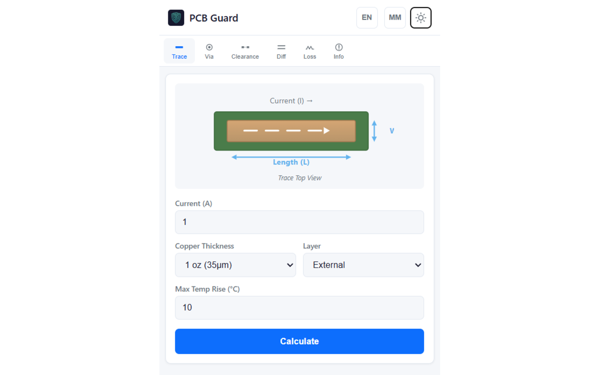
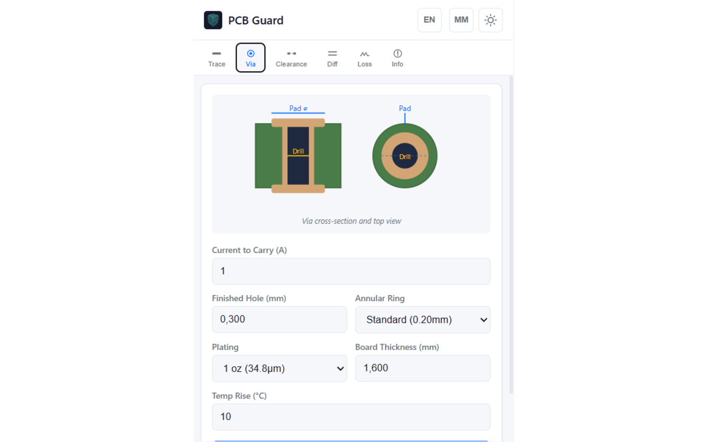
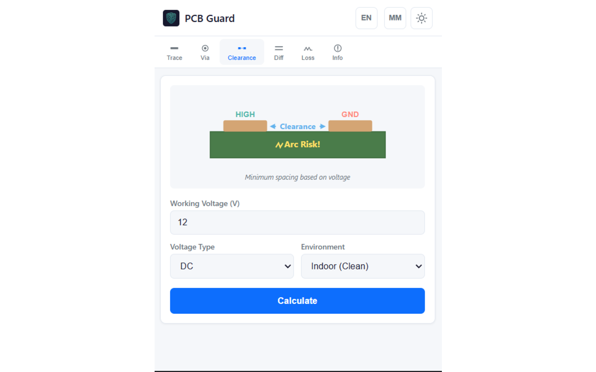
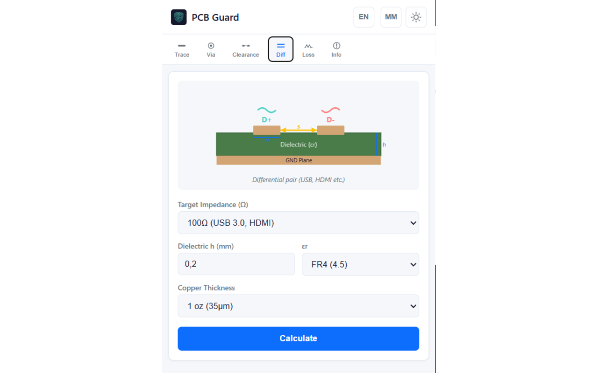

# PCB Guard

PCB tasarımı sırasında sık kullanılan iz, via, açıklık ve empedans hesaplarını tek bir çevrimdışı araçta toplamak için hazırlanmış Chrome eklentisi.

İlk aktarımın kaynak tabanı: **1.0.0** · Chrome Manifest V3

[Güncel GitHub sürümü ve kurulum ZIP’i](https://github.com/furkanyrtsvr/google-extensions/releases?q=pcb-guard-v&expanded=true)

## Özellikler

- İz genişliği ve akım/sıcaklık parametreleriyle çalışma.
- Via boyutlandırma ve akım kapasitesi tahmini.
- Diferansiyel çift/empedans ve clearance hesapları.
- Gerilim düşümü/kayıp hesapları; hazır ayarlar, birimler, tema ve dil seçenekleri.

## Kurulum

Chrome Web Store kimliği: `impdbdcoeknblhnpnbbnjhnjbcenhfkh`. [Mağaza sayfası](https://chromewebstore.google.com/detail/impdbdcoeknblhnpnbbnjhnjbcenhfkh). Mağazanın güncel yayın durumu bu aktarımda doğrulanmadı.

Kaynak kodundan kurulum:

1. `google-extensions` deposunu klonlayıp `pcb-guard/` klasörünü kullanın veya yukarıdaki bağlantıdan yalnızca bu eklentinin kurulum ZIP’ini indirip açın.
2. Chrome’da `chrome://extensions` sayfasını açın.
3. Geliştirici modunu açın ve **Paketlenmemiş öğe yükle / Load unpacked** seçeneğini kullanın.
4. Doğrudan `manifest.json` içeren klasörü seçin.
5. Eklentiyi araç çubuğuna sabitleyin. Kaynağı güncellediğinizde eklenti kartındaki Yeniden yükle düğmesine basın ve hedef sayfayı yenileyin.

Node.js/npm kurulumu eklentiyi kullanmak için gerekmez. Edge’de geliştirici modu ve paketlenmemiş eklenti akışı benzerdir; bu aktarımda ayrıca doğrulanmadı.

## Kullanım

Araç çubuğundan PCB Guard’ı açın. İlgili hesap sekmesini seçin; kart malzemesi, geometrisi ve elektriksel değerleri girip Calculate düğmesine basın. Birimleri ve hazır ayarları kontrol edin. Ayrıntılar [kullanım kılavuzunda](KULLANIM_KILAVUZU.md).

## Görseller

Aşağıdaki dört görsel kullanıcı tarafından sağlanan tanıtım arşivinden alınmıştır.

### İz genişliği hesabı



### Via boyutlandırma



### Açıklık hesabı



### Diferansiyel çift hesabı



## İzinler ve veri akışı

storage: hesap ayarları ve tercihler. Manifest sayfa okuma veya geniş host izni istemez.

## Geliştirme ve kontrol

Komutları deponun `pcb-guard/` klasöründe çalıştırın.

```sh
node scripts/check-extension.mjs
node scripts/run-tests.mjs
```

Kontrol, manifestte başvurulan dosyaları ve JavaScript sözdizimini doğrular. Bu, gerçek Chrome uzantı API’lerinin veya harici sitelerin uçtan uca kabul testi değildir.

## Sınırlar

Sonuçlar kodda tanımlı mühendislik modellerinin tahminleridir; üretici stackup verisi, saha ölçümü veya resmi uygunluk doğrulamasının yerine geçmez. Kaynak kılavuzundaki standart atıfları, bütün uygulamanın sertifikalı olduğu anlamına gelmez.

## Sürümler ve kaynak düzeni

`manifest.json` eklenti giriş noktalarını tanımlar. README görselleri `docs/images/`, yerel kontrol araçları `scripts/`, ortak paketleme/sürüm araçları deponun `../maintenance/scripts/` altındadır. Chrome tarafından üretilen `_metadata` dosyaları kaynak depoya alınmadı. Manifestteki `key` mağaza kimliğini koruyan açık anahtardır; özel imzalama anahtarı değildir.

`google-extensions` deposunun main dalında bu eklentinin çalışma dosyaları değiştiğinde kontrollerden sonra bağımsız `pcb-guard-vMAJOR.MINOR.PATCH` etiketi, GitHub Release ve kurulum ZIP’i üretilir. Diğer eklentilerin sürümü değişmez; yalnızca README/görsel değişiklikleri yeni sürüm çıkarmaz. GitHub sürümü yayımlamak Chrome Web Store’a otomatik gönderim yapmaz. [Sürüm rehberi](docs/SURUMLEME.md).

## Lisans

Bu kaynak aktarımı yeni bir proje lisansı atamaz. Depodaki üçüncü taraf kütüphanelerin gömülü telif ve lisans bildirimleri korunmuştur. Ayrı bir açık kaynak lisansı belirlenmeden kullanım/dağıtım haklarının serbest olduğu varsayılmamalıdır.

[← Google Extensions koleksiyonu](../README.md)
